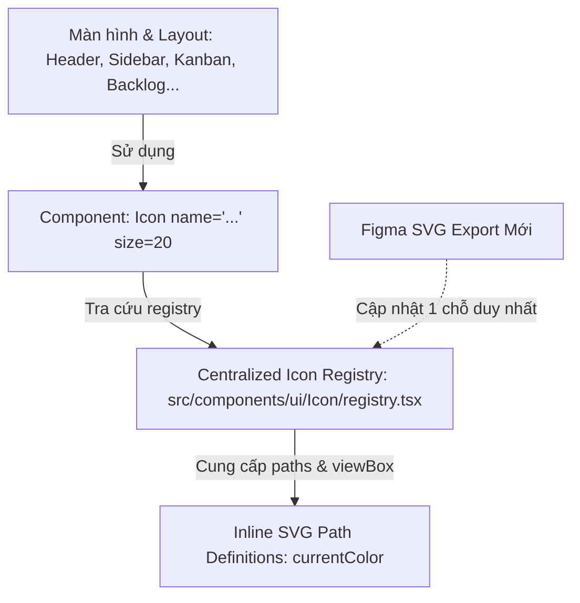

# Hệ Thống Icon SVG Tái Sử Dụng (Replaceable SVG Icon System) — Taiga ScrumBan

> **Mục tiêu**: Xây dựng hệ thống icon SVG tập trung, độc lập, có thể thay thế (replaceable) linh hoạt trong toàn bộ ứng dụng React + TypeScript, tuân thủ nguyên tắc không nhúng trực tiếp thẻ `<svg>` trong các màn hình nghiệp vụ, đồng thời hỗ trợ styling động qua Design Tokens và Tailwind CSS v4.

---

## 1. Tổng Quan Kiến Trúc (Architecture Overview)



### Tại sao không dùng thẻ `` với file SVG ngoài?
- Khi load SVG qua ``, trình duyệt cô lập tài liệu SVG trong shadow DOM độc lập. Do đó, các thuộc tính CSS như `color`, `currentColor`, class Tailwind (ví dụ `text-primary-500`, `text-neutral-600`) và CSS variables **không thể tác động** vào màu sắc của các nét vẽ bên trong SVG.
- Hệ thống Taiga sử dụng mô hình **Inline SVG Paths trong Registry tập trung** (`registry.tsx`): vừa đảm bảo hiệu năng tải trang (không thêm HTTP request), vừa tận dụng 100% sức mạnh của `currentColor` và Design Tokens.

---

## 2. Giao Diện Lập Trình (Icon Component API)

### 2.1. Cú pháp sử dụng chuẩn

```tsx
import { Icon } from '@/components/ui'

// Sử dụng mặc định (thừa hưởng màu chữ từ thẻ cha hoặc class Tailwind)
<Icon name="search" size={20} className="text-neutral-600 hover:text-primary-600" />

// Sử dụng với ghi đè màu trực tiếp (Direct color override)
<Icon name="check-circle" size={16} color="var(--color-success-500)" />

// Sử dụng có ý nghĩa ngữ nghĩa (Accessible with screen reader support)
<Icon name="trash" size={18} aria-label="Xóa nhiệm vụ" />
```

### 2.2. Bảng tham số (Props Reference)

| Tên Prop | Kiểu dữ liệu | Mặc định | Mô tả |
|---|---|---|---|
| `name` | `IconName` | *Bắt buộc* | Tên định danh ổn định của icon (được type-check chặt chẽ bằng TypeScript union). |
| `size` | `number \| string` | `undefined` | Kích thước icon: truyền số nguyên (ví dụ: `16`, `20`, `24` -> `16px`) hoặc chuỗi CSS (`'1.25rem'`). Nếu bỏ trống, có thể dùng class Tailwind `w-* h-*` trong `className`. |
| `color` | `string` | `undefined` | Màu sắc trực tiếp ghi đè (hex, rgb, CSS variable). Áp dụng qua inline `style={{ color }}`. |
| `className` | `string` | `''` | Các class bổ trợ của Tailwind CSS v4 (màu chữ, margin, transition, transform). |
| `aria-label` | `string` | `undefined` | Nhãn trợ năng cho trình đọc màn hình. Khi có prop này, icon tự động chuyển sang chế độ `role="img"`. |
| `title` | `string` | `undefined` | Tiêu đề tooltip native (render thẻ `<title>` bên trong SVG). |
| `decorative` | `boolean` | `true` (khi không có aria-label/title) | Ẩn icon khỏi cây trợ năng (`aria-hidden="true"`). Tự động tắt khi có `aria-label`. |

### 2.3. Quy tắc ưu tiên thứ tự áp dụng kiểu dáng (Style Precedence)

1. **Màu sắc (Color Precedence)**:
   - Mặc định, tất cả các đường vẽ SVG sử dụng `currentColor`.
   - Nếu truyền prop `color` (ví dụ `color="#076859"`), thuộc tính inline style `color` sẽ được áp dụng, có độ ưu tiên cao nhất ghi đè lên các class màu chữ của Tailwind.
   - Nếu không truyền prop `color`, màu của icon sẽ kế thừa trực tiếp từ class màu chữ Tailwind trong `className` (ví dụ `className="text-neutral-500 hover:text-primary-500"`).
2. **Kích thước (Size Precedence)**:
   - Nếu truyền prop `size` (ví dụ `size={20}`), icon sẽ nhận `style={{ width: '20px', height: '20px' }}`.
   - Nếu không truyền `size`, kích thước sẽ được điều khiển linh hoạt bằng các class Tailwind trong `className` (ví dụ `w-4 h-4` hoặc `w-6 h-6`).

---

## 3. Quy Trình Thay Thế Icon Tạm Thời Bằng SVG Figma Chính Thức

Hiện tại, tất cả các icon trong hệ thống đang được kích hoạt dưới dạng **Icon tạm thời chất lượng cao (High-fidelity Temporary Icons)** với cờ `isTemporary: true` trong `src/components/ui/Icon/registry.tsx`.

Khi có tệp SVG chính thức được trích xuất từ Figma:

### Các bước thực hiện:
1. **Bước 1**: Trong Figma, chọn icon mong muốn -> Chuột phải -> **Copy as SVG** (hoặc Export -> SVG).
2. **Bước 2**: Mở tệp SVG vừa lấy và sao chép các phần tử bên trong (thẻ `<path>`, `<g>`, `<circle>`).
3. **Bước 3**: Mở [src/components/ui/Icon/registry.tsx](file:///d:/personal/MyTaiga/src/components/ui/Icon/registry.tsx).
4. **Bước 4**: Tìm đúng `name` của icon (ví dụ: `kanban`).
5. **Bước 5**:
   - Cập nhật `viewBox` nếu SVG từ Figma dùng tỉ lệ khác `0 0 24 24`.
   - Thay thế hàm `render: () => (...)` bằng các thẻ path của Figma.
   - Đảm bảo các thuộc tính màu dùng `stroke="currentColor"` hoặc `fill="currentColor"`.
   - Đổi cờ `isTemporary: false`.
6. **Bước 6**: Lưu file và kiểm tra giao diện! **Toàn bộ các màn hình đang sử dụng icon này sẽ tự động cập nhật ngay lập tức mà không cần sửa bất kỳ file JSX nào khác.**

---

## 4. Danh Mục Toàn Bộ 45 Icon Hiện Có (Icon Inventory)

| Tên Icon (`name`) | Phân loại | Nhãn tiếng Việt | Trạng thái | Nơi sử dụng chính |
|---|---|---|:---:|---|
| `dashboard` | Điều hướng | Tổng quan / Trang chủ | Tạm thời | Sidebar, Breadcrumbs |
| `kanban` | Điều hướng | Bảng Kanban | Tạm thời | Sidebar, Kanban board |
| `backlog` | Điều hướng | Product Backlog | Tạm thời | Sidebar, PBI lists |
| `sprint` | Điều hướng | Sprint | Tạm thời | Sidebar, Sprint planning |
| `epic` | Điều hướng | Epic | Tạm thời | Sidebar, Epic detail |
| `bug` | Điều hướng | Lỗi / Bug | Tạm thời | Sidebar, Bug tracking |
| `metrics` | Điều hướng | Flow Metrics | Tạm thời | Sidebar, Analytics |
| `members` | Điều hướng | Thành viên & Nhóm | Tạm thời | Sidebar, Member roster |
| `chat` | Điều hướng | Trò chuyện / Chat | Tạm thời | Sidebar, Discussions |
| `settings` | Điều hướng | Cài đặt hệ thống | Tạm thời | Sidebar user footer, Settings |
| `shield` | Điều hướng | Bảo mật & Quản trị | Tạm thời | Admin, Role matrix |
| `search` | Thao tác | Tìm kiếm | Tạm thời | Header Ctrl+K, Filter bars |
| `plus` | Thao tác | Thêm mới / Tạo | Tạm thời | Header "+ Tạo", ProjectHeader "+ Thêm việc" |
| `edit` | Thao tác | Chỉnh sửa / Sửa | Tạm thời | Inline edit, Card actions |
| `trash` | Thao tác | Xóa / Thùng rác | Tạm thời | Delete dialogs |
| `close` | Thao tác | Đóng / Hủy | Tạm thời | Modal close, Drawer close |
| `menu` | Thao tác | Menu điều hướng | Tạm thời | Mobile hamburger button |
| `more-horizontal` | Thao tác | Thêm tùy chọn (Ngang) | Tạm thời | Card context menu |
| `more-vertical` | Thao tác | Thêm tùy chọn (Dọc) | Tạm thời | Table row context menu |
| `check` | Thao tác | Đã chọn / Tick | Tạm thời | Checkbox, DoD checklist |
| `filter` | Thao tác | Bộ lọc | Tạm thời | Filter bar |
| `sliders` | Thao tác | Cấu hình luồng / Tùy chỉnh | Tạm thời | ProjectHeader "Cấu hình luồng" |
| `sort` | Thao tác | Sắp xếp | Tạm thời | Table headers |
| `send` | Thao tác | Gửi / Phản hồi | Tạm thời | TaskDetailPanel bình luận nhanh, Chat |
| `external-link` | Thao tác | Mở liên kết ngoài / Tab mới | Tạm thời | TaskDetailPanel tab mới |
| `paperclip` | Thao tác | Đính kèm tệp | Tạm thời | Upload attachment, Chat |
| `download` | Thao tác | Tải xuống | Tạm thời | File preview, Report export |
| `refresh` | Thao tác | Làm mới / Thử lại | Tạm thời | Offline error banner, Sync |
| `copy` | Thao tác | Sao chép | Tạm thời | Copy key, Copy code snippet |
| `chevron-down` | Hướng | Mũi tên xuống | Tạm thời | Dropdown select |
| `chevron-up` | Hướng | Mũi tên lên | Tạm thời | Accordion toggle |
| `chevron-left` | Hướng | Mũi tên trái | Tạm thời | Pagination previous |
| `chevron-right` | Hướng | Mũi tên phải | Tạm thời | Pagination next |
| `chevrons-up-down` | Hướng | Bộ chọn lên xuống | Tạm thời | Sidebar project switcher |
| `arrow-right` | Hướng | Mũi tên ngang sang phải | Tạm thời | Stepper next |
| `arrow-left` | Hướng | Mũi tên ngang sang trái | Tạm thời | Back button |
| `bell` | Chỉ số | Chuông thông báo | Tạm thời | Topbar notification bell |
| `calendar` | Chỉ số | Lịch / Ngày tháng | Tạm thời | Datepicker, Sprint duration |
| `clock` | Chỉ số | Đồng hồ / Hạn chót | Tạm thời | SprintBanner WIP, ActivityTimelineCard |
| `user` | Chỉ số | Người dùng | Tạm thời | Profile, Assignee picker |
| `users` | Chỉ số | Nhóm người dùng | Tạm thời | Team roster, Capacity |
| `flag` | Chỉ số | Cờ / Cam kết | Tạm thời | SprintBanner cam kết SP |
| `tag` | Chỉ số | Thẻ nhãn / Tag | Tạm thời | Label selector |
| `folder` | Chỉ số | Thư mục / Dự án | Tạm thời | Project card |
| `lock` | Trạng thái | Đã khóa | Tạm thời | PBI lock, Account locked |
| `unlock` | Trạng thái | Đã mở khóa | Tạm thời | Account unlocked |
| `eye` | Thao tác | Xem / Hiển thị | Tạm thời | Preview lightbox, Show password |
| `eye-off` | Thao tác | Ẩn mật khẩu | Tạm thời | Password input toggle |
| `check-circle` | Trạng thái | Thành công / Hoàn thành | Tạm thời | SprintBanner đã đạt SP, Toast success |
| `alert-triangle` | Trạng thái | Cảnh báo / Vượt WIP | Tạm thời | WIP limit alert banner, Warning toast |
| `alert-circle` | Trạng thái | Lỗi / Danger | Tạm thời | Error notice, Danger toast |
| `info` | Trạng thái | Thông tin / Hướng dẫn | Tạm thời | Info card, Empty state |
| `message-square` | Chỉ số | Bình luận / Tin nhắn | Tạm thời | Comment count badge |
| `file-text` | Chỉ số | Tài liệu / Tiêu chí nghiệm thu | Tạm thời | Acceptance criteria, Log |

---

## 5. Màn Hình Thử Nghiệm Tương Tác (Developer Preview)

Một trang trưng bày trực quan đã được tích hợp tại tuyến đường `/icons`:
- Tìm kiếm tức thì theo tên icon hoặc nhãn tiếng Việt.
- Lọc theo danh mục: Điều hướng, Hành động, Mũi tên, Trạng thái, Chỉ số.
- Thay đổi kích thước hiển thị trực tiếp: `16px`, `20px`, `24px`, `32px`.
- Kiểm tra bảng màu trực quan (Primary `#076859`, Success `#107e3e`, Danger `#b52a2a`, Warning `#bd6a00`, Info `#0c6ca8`).
- Nhấp chuột 1 chạm để sao chép mã JSX vào clipboard.
