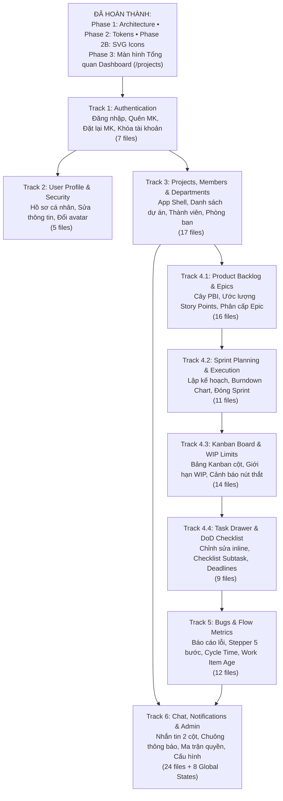

# UI Implementation Roadmap — Taiga ScrumBan Flow

> **Tài liệu chiến lược**: Lộ trình triển khai giao diện người dùng theo 6 nhóm tính năng (Tracks) dựa trên 126 ảnh tham khảo trong `design/references/`, phân bổ theo các phân đoạn nhỏ (increments) có nhận biết về sự phụ thuộc (dependency-aware), xác định rõ các màn hình đã triển khai vs chưa triển khai, các giả định và thành phần dùng chung.

---

## 1. Bản Đồ Tổng Thể & Trật Tự Phụ Thuộc (Dependency Graph)

---

## 2. Chi Tiết 6 Nhóm Tính Năng (Tracks Breakdown)

---

### Track 1: Authentication (Xác thực & Khôi phục tài khoản)

- **Mục tiêu**: Thiết lập luồng đăng nhập, khôi phục mật khẩu, xác thực biểu mẫu, thông báo thành công và xử lý tài khoản bị vô hiệu hóa.
- **Trạng thái thực tế**:
  - Đã có tài liệu thiết kế tham khảo: **7 màn hình**.
  - Đã triển khai mã nguồn: **Chưa triển khai (0/7)**.
- **Danh sách tệp tham khảo chính xác (`design/references/`)**:
  1. `Đăng nhập - ScrumBan Flow.png` (Màn hình đăng nhập tiêu chuẩn)
  2. `Đăng nhập thất bại - ScrumBan Flow.png` (Trạng thái báo lỗi sai email/mật khẩu)
  3. `Quên mật khẩu - ScrumBan Flow.png` (Form nhập email yêu cầu cấp lại)
  4. `Đã gửi email đặt lại - ScrumBan Flow.png` (Thông báo xác nhận đã gửi hướng dẫn qua email)
  5. `Đặt lại mật khẩu - ScrumBan Flow.png` (Form thiết lập mật khẩu mới kèm xác nhận)
  6. `Đã đăng xuất - ScrumBan Flow.png` (Màn hình thông báo kết thúc phiên làm việc an toàn)
  7. `Tài khoản bị khóa - ScrumBan Flow.png` (Màn hình thông báo tài khoản bị đình chỉ bởi quản trị viên)
- **Sự phụ thuộc (Dependencies)**: Không phụ thuộc luồng nội bộ nào; chỉ cần Design Tokens (Màu sắc, Typography) và `Icon` component.
- **Thành phần dùng chung (Shared Components)**:
  - `AuthLayout` (Khung căn giữa thẻ xác thực trên nền `paper-100`)
  - `Input` (Ô nhập liệu có hỗ trợ icon trước/sau, thông báo lỗi đỏ)
  - `Button` (Nút bấm với trạng thái loading spinner)
  - `AlertBanner` (Khung cảnh báo màu đỏ/xanh)
- **Màn hình còn thiếu & Giả định ghi nhận**:
  - *Màn hình thiếu*: Chưa có màn hình "Đăng ký tài khoản mới" trong tham khảo (hệ thống vận hành theo cơ chế mời nội bộ bởi Admin).
  - *Giả định*: Nút toggle ẩn/hiện mật khẩu (eye / eye-off) trên ô mật khẩu; mock service giả lập độ trễ 400ms và kiểm tra email `admin@scrumflow.io`.

---

### Track 2: User Profile & Security (Hồ sơ cá nhân & Bảo mật)

- **Mục tiêu**: Cho phép người dùng xem chi tiết hồ sơ cá nhân, chỉnh sửa họ tên, thông tin liên hệ và tải ảnh đại diện mới.
- **Trạng thái thực tế**:
  - Đã có tài liệu thiết kế tham khảo: **5 màn hình**.
  - Đã triển khai mã nguồn: **Chưa triển khai (0/5)**.
- **Danh sách tệp tham khảo chính xác**:
  1. `Hồ sơ cá nhân - ScrumBan Flow.png` (Trang hồ sơ tổng quan, thông tin liên lạc, vai trò)
  2. `Sửa họ tên - ScrumBan Flow.png` (Modal chỉnh sửa họ và tên)
  3. `Sửa email và số điện thoại (Lỗi) - ScrumBan Flow.png` (Modal kiểm tra định dạng email và sđt không hợp lệ)
  4. `Đổi ảnh đại diện - ScrumBan Flow.png` (Modal tải lên ảnh avatar và xem trước)
  5. `Đã cập nhật hồ sơ - ScrumBan Flow.png` (Thông báo Toast xác nhận lưu thông tin thành công)
- **Sự phụ thuộc**: Phụ thuộc vào `AppLayout` (hoặc mở từ User Menu góc dưới Sidebar).
- **Thành phần dùng chung**: `Modal`, `Input`, `Avatar`, `Button`, `Toast`, `Tabs`.
- **Màn hình còn thiếu & Giả định**:
  - *Màn hình thiếu*: Màn hình đổi mật khẩu khi đang đăng nhập (in-session password change).
  - *Giả định*: Dữ liệu cập nhật hồ sơ được phản ánh đồng bộ lên Avatar trên Topbar và Sidebar.

---

### Track 3: Projects, Members & Departments (Dự án, Thành viên & Phòng ban)

- **Mục tiêu**: Xây dựng trung tâm điều phối không gian làm việc (Workspace), danh sách dự án cá nhân/quản lý, quản lý đội ngũ nhân sự dự án, cơ cấu phòng ban và App Shell mở rộng.
- **Trạng thái thực tế**:
  - Đã có tài liệu thiết kế tham khảo: **17 màn hình** (5 Dự án + 12 Thành viên & Phòng ban).
  - Đã triển khai mã nguồn: **1 màn hình** (`dashboard.png` / `Group 1.png` tại `/projects` - xem tổng quan 1 dự án).
- **Danh sách tệp tham khảo chính xác**:
  - *Quản lý Dự án (5 files)*:
    1. `Dự án của tôi (Quản lý) - ScrumBan Flow.png` (Danh sách thẻ dự án, số thành viên, tiến độ hoàn thành)
    2. `Tạo dự án mới - ScrumBan Flow.png` (Modal khởi tạo dự án mới, chọn Scrum/Kanban)
    3. `Chỉnh sửa dự án - ScrumBan Flow.png` (Modal/Form cài đặt thông tin dự án)
    4. `Tùy chọn dự án (Menu) - ScrumBan Flow.png` (Menu ngữ cảnh 3 chấm trên thẻ dự án)
    5. `Xác nhận Đóng và Xóa dự án - ScrumBan Flow.png` (Dialog nguy hiểm yêu cầu gõ tên dự án để xóa)
  - *Thành viên & Phòng ban (12 files)*:
    6. `Danh sách Thành viên - ScrumBan Flow.png` (Bảng quản trị nhân sự, vai trò, email)
    7. `Thêm thành viên - ScrumBan Flow.png` (Modal mời thành viên vào dự án)
    8. `Lỗi thêm thành viên - ScrumBan Flow.png` (Cảnh báo email không tồn tại hoặc đã có trong dự án)
    9. `Xác nhận loại bỏ thành viên - ScrumBan Flow.png` (Dialog tước quyền truy cập khỏi dự án)
    10. `Thông tin nhóm & Quản lý thành viên - ScrumBan Flow.png` (Panel chi tiết nhóm & phân bổ công việc)
    11. `Tìm kiếm, Bộ lọc & Quyền Thành viên - ScrumBan Flow.png` (Bộ lọc theo vai trò và phòng ban)
    12. `Chuyển phòng ban & Giao diện Thành viên - ScrumBan Flow.png` (Modal luân chuyển phòng ban)
    13. `Thêm phòng ban mới - ScrumBan Flow.png` (Modal thêm phòng ban)
    14. `Chỉnh sửa phòng ban - ScrumBan Flow.png` (Modal sửa thông tin phòng ban)
    15. `Xác nhận Xóa phòng ban - ScrumBan Flow.png` (Dialog xóa phòng ban khi không còn nhân sự)
    16. `Giao diện Thành viên (Member's View) - ScrumBan Flow.png` (Giao diện bị giới hạn quyền chỉ xem)
    17. `Giao diện Thành viên & Trạng thái rỗng - ScrumBan Flow.png` (Bảng thành viên rỗng)
- **Sự phụ thuộc**: Mở rộng từ `AppLayout`, kết nối bộ chuyển dự án (`ProjectPicker`) trên Header.
- **Thành phần dùng chung**: `ProjectCard`, `Table`, `Badge`, `Avatar`, `AvatarGroup`, `Modal`, `ConfirmDialog`, `DropdownMenu`, `SearchInput`.
- **Màn hình còn thiếu & Giả định**:
  - *Màn hình thiếu*: Màn hình rỗng khi người dùng chưa thuộc bất kỳ dự án nào.
  - *Giả định*: Quyền xem danh sách thành viên cho phép lọc theo phòng ban (Engineering, Design, QA, Product).

---

### Track 4: Connected Scrum Workflows (Lõi ScrumBan theo từng bước tăng dần)

Track này liên kết toàn bộ vòng đời ScrumBan và được chia thành **4 phân đoạn nhỏ (Increments)**:

#### Phân đoạn 4.1: Product Backlog & Epics Hierarchy (16 files)
- **Trạng thái**: Chưa triển khai (0/16).
- **Danh sách tệp tham khảo chính xác**:
  - Backlog (10 files): `Backlog sản phẩm - ScrumBan Flow.png`, `Html → Body.png`, `Html → Body-1.png`, `Html → Body-2.png`, `Chi tiết PBI (Drawer) - ScrumBan Flow.png`, `Tạo PBI mới - ScrumBan Flow.png`, `Lỗi kiểm tra tạo PBI - ScrumBan Flow.png`, `Kéo thả PBI & Gán Sprint - ScrumBan Flow.png`, `Liên kết PBI với Epic - ScrumBan Flow.png`, `Xác nhận xóa PBI & Khóa PBI - ScrumBan Flow.png`.
  - Epic (6 files): `Danh sách Epic - ScrumBan Flow.png`, `Chi tiết Epic & Danh sách PBI - ScrumBan Flow.png`, `Tạo Epic mới - ScrumBan Flow.png`, `Tiến độ Epic (Thanh phân bổ & Số liệu) - ScrumBan Flow.png`, `Liên kết Task với Epic - ScrumBan Flow.png`, `Xác nhận Xóa Epic - ScrumBan Flow.png`.
- **Sản phẩm**: Tuyến đường `/projects/:id/backlog` và `/projects/:id/epics`, drawer xem AC PBI, thanh phân bổ tiến độ Epic đa đoạn.

#### Phân đoạn 4.2: Sprint Planning, Execution & Closing (11 files)
- **Trạng thái**: Chưa triển khai (0/11).
- **Danh sách tệp tham khảo chính xác**:
  `Danh sách Sprint phân nhóm - ScrumBan Flow.png`, `Chi tiết Sprint 14 (Đang chạy) - ScrumBan Flow.png`, `Lập kế hoạch Sprint (Sprint Planning) - ScrumBan Flow.png`, `Tạo Sprint mới & Lỗi trùng ngày - ScrumBan Flow.png`, `Lỗi ngày kết thúc - ScrumBan Flow.png`, `Chỉnh sửa Sprint - ScrumBan Flow.png`, `Modal Đóng Sprint - ScrumBan Flow.png`, `Sprint đã đóng (Chế độ Chỉ đọc) - ScrumBan Flow.png`, `Xác nhận Xóa Sprint - ScrumBan Flow.png`, `Biểu đồ Burndown Sprint 14 - ScrumBan Flow.png`, `Throughput theo Sprint - ScrumBan Flow.png`.
- **Sản phẩm**: Tuyến đường `/projects/:id/sprints`, tính toán capacity Story Points, biểu đồ Burndown SVG, modal đóng Sprint chuyển giao việc dở dang.

#### Phân đoạn 4.3: Kanban Board & WIP Limit Control (14 files)
- **Trạng thái**: Chưa triển khai (0/14).
- **Danh sách tệp tham khảo chính xác**:
  `Bảng Kanban mặc định - ScrumBan Flow.png`, `Html → Body-3.png`, `Html → Body-4.png`, `Html → Body-5.png`, `Bảng Kanban trạng thái rỗng - ScrumBan Flow.png`, `Kéo thả thẻ trên Bảng Kanban - ScrumBan Flow.png`, `Thu gọn cột trên Bảng Kanban - ScrumBan Flow.png`, `Lọc thẻ theo Thành viên - ScrumBan Flow.png`, `Tìm kiếm từ khóa trên Bảng Kanban - ScrumBan Flow.png`, `Cài đặt Giới hạn WIP - ScrumBan Flow.png`, `Cảnh báo vượt giới hạn WIP - ScrumBan Flow.png`, `Cảnh báo Vượt giới hạn WIP trên Bảng - ScrumBan Flow.png`, `Lỗi kiểm tra Giới hạn WIP - ScrumBan Flow.png`, `Nhật ký Cảnh báo WIP (Quản lý) - ScrumBan Flow.png`, `Xác nhận Xóa giới hạn WIP - ScrumBan Flow.png`.
- **Sản phẩm**: Tuyến đường `/projects/:id/kanban`, kéo thả thẻ giữa các cột, tính toán vi phạm WIP (> WIP Max) làm đổi màu cột và hiện banner cảnh báo.

#### Phân đoạn 4.4: Task Drawer, Subtasks & Deadlines (9 files)
- **Trạng thái**: Đã có phiên bản cơ sở tại màn hình Dashboard Phase 3 (`TaskDetailPanel.tsx`); cần mở rộng thành component độc lập hoàn chỉnh (0/9 độc lập).
- **Danh sách tệp tham khảo chính xác**:
  `Modal Tạo Task nhanh - ScrumBan Flow.png`, `Task Drawer mặc định - ScrumBan Flow.png`, `Chỉnh sửa thuộc tính Task - ScrumBan Flow.png`, `Nhiệm vụ con Subtask & Tiến độ - ScrumBan Flow.png`, `Bộ chọn Hạn chót & Mức độ ưu tiên - ScrumBan Flow.png`, `Giao Task & Đổi người thực hiện - ScrumBan Flow.png`, `Danh sách Task Quá hạn - ScrumBan Flow.png`, `Cảnh báo Quá hạn & Sắp đến hạn - ScrumBan Flow.png`, `Xác nhận Xóa Task - ScrumBan Flow.png`.
- **Sản phẩm**: `TaskDrawer` dùng chung ở Dashboard, Kanban và Backlog; checklist subtask tự tính % tiến độ, picker hạn chót và đổi người làm.

---

### Track 5: Bugs & Flow Metrics (Theo dõi Lỗi & Đo lường Dòng chảy)

- **Mục tiêu**: Xử lý chuyên sâu cho đối tượng Bug với Stepper kiểm soát quy trình nghiệm thu, và phân tích các chỉ số dòng chảy Agile (Cycle Time, Work Item Age).
- **Trạng thái thực tế**:
  - Đã có tài liệu thiết kế tham khảo: **12 màn hình** (8 Bugs + 4 Flow Metrics).
  - Đã triển khai mã nguồn: **Chưa triển khai (0/12)**.
- **Danh sách tệp tham khảo chính xác**:
  - *Bug Tracking (8 files)*:
    1. `Danh sách Bug - ScrumBan Flow.png` (Bảng quản lý lỗi, mức độ nghiêm trọng, trạng thái)
    2. `Modal Báo cáo Bug - ScrumBan Flow.png` (Modal nhập các bước tái hiện lỗi, ảnh đính kèm)
    3. `Chi tiết Bug - ScrumBan Flow.png` (Trang/Drawer chi tiết lỗi)
    4. `Quy trình Trạng thái Bug (Stepper) - ScrumBan Flow.png` (Stepper 5 bước chuyển trạng thái)
    5. `Giao Bug cho Thành viên - ScrumBan Flow.png` (Dropdown gán kỹ sư sửa lỗi)
    6. `Lỗi kiểm tra Trạng thái Bug - ScrumBan Flow.png` (Cảnh báo không được đóng lỗi khi chưa kiểm thử)
    7. `Xác nhận Đóng Bug - ScrumBan Flow.png` (Modal nghiệm thu giải pháp trước khi đóng)
    8. `Xác nhận Xóa Bug - ScrumBan Flow.png` (Dialog xóa bug báo nhầm)
  - *Flow Metrics (4 files)*:
    9. `Tổng quan Flow Metrics - ScrumBan Flow.png` (4 KPI: Cycle Time, Lead Time, WIP, Throughput)
    10. `Flow Metrics Trạng thái rỗng - ScrumBan Flow.png` (Cảnh báo chưa đủ 5 task hoàn thành)
    11. `Cycle Time & Tác vụ chậm nhất - ScrumBan Flow.png` (Scatter plot và bảng task tắc nghẽn nhất)
    12. `Work Item Age & Thẻ tồn đọng - ScrumBan Flow.png` (Biểu đồ tuổi thọ thẻ đang làm dở)
- **Sự phụ thuộc**: Dữ liệu hoàn thành từ Track 4 (Sprint & Kanban).
- **Thành phần dùng chung**: `WorkflowStepper`, `ScatterPlotChart`, `AgingBarChart`, `SeverityBadge`, `Table`, `Modal`.

---

### Track 6: Chat, Notifications, Admin & Global States (Giao tiếp & Quản trị)

- **Mục tiêu**: Kênh thảo luận nhóm, xem thông báo thời gian thực, quản trị người dùng toàn hệ thống, ma trận phân quyền và các màn hình ngoại lệ (403, 404, offline, hết phiên).
- **Trạng thái thực tế**:
  - Đã có tài liệu thiết kế tham khảo: **32 màn hình** (12 Chat + 5 Thông báo + 7 Admin + 8 Global States).
  - Đã triển khai mã nguồn: **Chưa triển khai (0/32)**.
- **Danh sách tệp tham khảo chính xác**:
  - *Trò chuyện & Tệp đính kèm (12 files)*:
    `Danh sách hội thoại & Khung chat mặc định - ScrumBan Flow.png`, `Tạo tin nhắn mới & Chọn thành viên - ScrumBan Flow.png`, `Tạo nhóm trao đổi mới (Quản lý) - ScrumBan Flow.png`, `Chi tiết Thread & Bong bóng tin nhắn - ScrumBan Flow.png`, `Tìm kiếm từ khóa trong hội thoại - ScrumBan Flow.png`, `Trạng thái rỗng (Chưa có cuộc trò chuyện) - ScrumBan Flow.png`, `Chỉ báo Tin nhắn mới & Vạch phân cách chưa đọc - ScrumBan Flow.png`, `Bình luận & Nhắc tên (@mention) - ScrumBan Flow.png`, `Chỉnh sửa & Xóa bình luận - ScrumBan Flow.png`, `Đính kèm tệp & Modal Xem trước tệp - ScrumBan Flow.png`, `Xem trước Tệp đính kèm - ScrumBan Flow.png`, `Tệp đính kèm & Cảnh báo dung lượng - ScrumBan Flow.png`.
  - *Thông báo & Dòng hoạt động (5 files)*:
    `Trang Danh sách Thông báo - ScrumBan Flow.png`, `Menu Thông báo thả xuống (Bell Dropdown) - ScrumBan Flow.png`, `Thông báo Cảnh báo Hạn chót - ScrumBan Flow.png`, `Thông báo Trạng thái rỗng - ScrumBan Flow.png`, `Nhật ký Hoạt động (Activity Timeline) - ScrumBan Flow.png`.
  - *Quản trị hệ thống & Phân quyền (7 files)*:
    `Quản lý Người dùng - ScrumBan Flow.png`, `Thêm người dùng mới - ScrumBan Flow.png`, `Xác nhận Khóa tài khoản - ScrumBan Flow.png`, `Xác nhận Mở khóa tài khoản - ScrumBan Flow.png`, `Lỗi Tự khóa Tài khoản - ScrumBan Flow.png`, `Phân quyền Vai trò - ScrumBan Flow.png`, `Cấu hình Hệ thống - ScrumBan Flow.png`.
  - *Trạng thái ngoại lệ toàn cục (8 files)*:
    `Skeleton Loaders cho Danh sách & Bảng - ScrumBan Flow.png`, `Bộ Trạng thái rỗng Chuẩn - ScrumBan Flow.png`, `Bộ Toast Thông báo Hệ thống - ScrumBan Flow.png`, `Cập nhật Thành công (Toast) - ScrumBan Flow.png`, `Modal Hết hạn Phiên làm việc - ScrumBan Flow.png`, `Lỗi kết nối & Thử lại - ScrumBan Flow.png`, `403 Không có quyền truy cập - ScrumBan Flow.png`, `404 Không tìm thấy trang - ScrumBan Flow.png`.
- **Sự phụ thuộc**: Tích hợp trên Topbar (`NotificationBell`), Sidebar (`Chat`, `Admin`) và Router level (Error boundary, 403, 404).

---

## 3. Tổng Hợp Ma Trận Tiến Độ Triển Khai (Status Matrix)

| Nhóm tính năng (Track) | Số lượng file thiết kế | Đã triển khai | Tỷ lệ hoàn thành | Trạng thái kỹ thuật |
|---|:---:|:---:|:---:|---|
| **Foundation & Design System** | 2 | 2 | 100% | React 19, TS 6, TW v4, 122 Tokens, 45 Icons |
| **Track 1: Authentication** | 7 | 0 | 0% | Sẵn sàng triển khai |
| **Track 2: User Profile** | 5 | 0 | 0% | Chờ Track 1 & App Shell |
| **Track 3: Projects, Members & Depts** | 17 | 1 (Dashboard) | 6% | Core screen đã chạy tại `/projects` |
| **Track 4.1: Backlog & Epics** | 16 | 0 | 0% | Chờ Track 3 |
| **Track 4.2: Sprint Planning** | 11 | 0 | 0% | Chờ Track 4.1 |
| **Track 4.3: Kanban & WIP** | 14 | 0 | 0% | Chờ Track 4.2 |
| **Track 4.4: Task Drawer & DoD** | 9 | 1 (cơ sở) | 11% | Sẵn sàng tách component độc lập |
| **Track 5: Bugs & Flow Metrics** | 12 | 0 | 0% | Chờ Track 4 |
| **Track 6: Chat, Notifications, Admin** | 32 | 0 | 0% | Tầng tích hợp cuối |
| **Tổng cộng** | **126 tệp** | **2 tệp (Dashboard)** | **~3% màn hình** | **100% Kiến trúc & Tokens & Icons** |

---

## 4. Khuyến Nghị Luồng Tiếp Theo Cần Triển Khai

### 🎯 Khuyến nghị: **Track 1 — Authentication (Xác thực & Khôi phục tài khoản)**
- **Lý do kỹ thuật & trải nghiệm**:
  1. **Tính độc lập hoàn toàn**: Track 1 không phụ thuộc bất kỳ dữ liệu dự án nào bên trong, là điểm bắt đầu tự nhiên nhất (`/login`) của toàn bộ ứng dụng.
  2. **Hoàn thiện chu trình xác thực mock**: Giúp định hình trạng thái đăng nhập (`auth state`), phân quyền tài khoản (Admin vs Thành viên) và kịch bản tài khoản bị khóa (`Tài khoản bị khóa - ScrumBan Flow.png`).
  3. **Bộ màn hình gọn gàng, liền mạch**: Gồm 7 màn hình liên hoàn (Đăng nhập -> Báo lỗi -> Quên mật khẩu -> Đã gửi email -> Đặt lại mật khẩu -> Thông báo đăng xuất).

### Danh sách 7 tệp tham khảo cần dùng cho Track 1:
1. `Đăng nhập - ScrumBan Flow.png`
2. `Đăng nhập thất bại - ScrumBan Flow.png`
3. `Quên mật khẩu - ScrumBan Flow.png`
4. `Đã gửi email đặt lại - ScrumBan Flow.png`
5. `Đặt lại mật khẩu - ScrumBan Flow.png`
6. `Đã đăng xuất - ScrumBan Flow.png`
7. `Tài khoản bị khóa - ScrumBan Flow.png`
