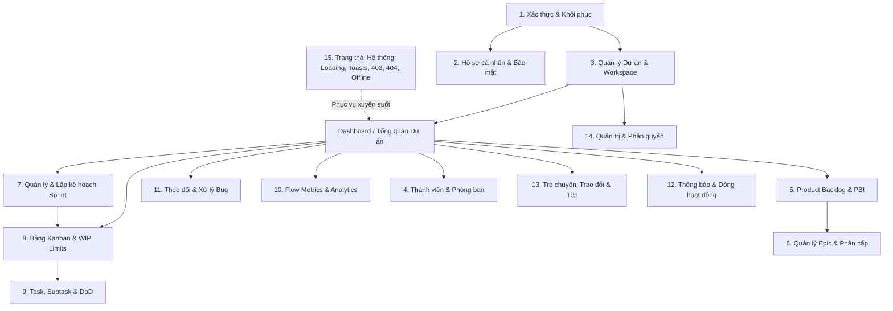

# User Flows Map — Taiga ScrumBan Flow

> **Mục tiêu**: Xây dựng bản đồ luồng người dùng chi tiết cho toàn bộ 15 miền nghiệp vụ của hệ thống MyTaiga.  
> **Nguyên tắc**: Dựa trên bằng chứng từ 126 ảnh chụp màn hình trong `design/references/`, phân định rõ ràng giữa **Yêu cầu đã được xác nhận (Confirmed)** và **Yêu cầu suy luận (Inferred)** để hoàn thiện trải nghiệm prototype tương tác độc lập với backend.

---

## Danh mục 15 Luồng Người Dùng (Flows Overview)

---

## Chi tiết từng Luồng Người Dùng

### Flow 1: Xác thực & Khôi phục tài khoản (Authentication & Account Recovery)

- **Mục tiêu**: Cho phép người dùng truy cập an toàn vào hệ thống, khôi phục quyền truy cập khi quên mật khẩu và bảo vệ phiên làm việc.
- **Điểm bắt đầu (Entry point)**: `/login`, `/forgot-password`, `/reset-password`
- **Các bước tương tác theo trình tự**:
  1. Người dùng truy cập `/login` (`Đăng nhập - ScrumBan Flow.png`).
  2. Nhập email và mật khẩu:
     - Nếu thông tin sai -> Hiển thị cảnh báo lỗi viền đỏ (`Đăng nhập thất bại - ScrumBan Flow.png`).
     - Nếu tài khoản đã bị vô hiệu hóa -> Chuyển sang màn hình cảnh báo khóa (`Tài khoản bị khóa - ScrumBan Flow.png`).
     - Nếu thông tin hợp lệ -> Đăng nhập thành công, chuyển hướng tới `/projects` (hoặc Dashboard).
  3. Khi quên mật khẩu: Người dùng nhấn "Quên mật khẩu?" -> Chuyển sang `/forgot-password` (`Quên mật khẩu - ScrumBan Flow.png`).
  4. Nhập email đã đăng ký -> Bấm "Gửi yêu cầu" -> Màn hình thông báo gửi thành công (`Đã gửi email đặt lại - ScrumBan Flow.png`).
  5. Người dùng click liên kết từ email -> Đến trang đặt lại mật khẩu `/reset-password` (`Đặt lại mật khẩu - ScrumBan Flow.png`).
  6. Nhập mật khẩu mới thỏa mãn độ mạnh -> Lưu thành công -> Chuyển về màn hình đăng nhập với thông báo Toast xanh.
  7. Khi người dùng bấm "Đăng xuất" từ menu cá nhân -> Hiển thị màn hình thông báo đã đăng xuất an toàn (`Đã đăng xuất - ScrumBan Flow.png`).
- **Ảnh tham khảo sử dụng**:
  - `Đăng nhập - ScrumBan Flow.png`
  - `Đăng nhập thất bại - ScrumBan Flow.png`
  - `Quên mật khẩu - ScrumBan Flow.png`
  - `Đã gửi email đặt lại - ScrumBan Flow.png`
  - `Đặt lại mật khẩu - ScrumBan Flow.png`
  - `Đã đăng xuất - ScrumBan Flow.png`
  - `Tài khoản bị khóa - ScrumBan Flow.png`
- **Yêu cầu đã xác nhận (Confirmed)**:
  - Form đăng nhập có checkbox "Ghi nhớ đăng nhập", link khôi phục mật khẩu.
  - Trạng thái thông báo lỗi đăng nhập xuất hiện ngay bên trên hoặc bên dưới form input.
  - Màn hình tài khoản bị khóa có nút liên hệ Admin hoặc quay lại đăng nhập.
- **Yêu cầu suy luận & đề xuất bổ sung (Inferred & Recommended)**:
  - *Suy luận*: Nút ẩn/hiện mật khẩu (eye toggle) trên ô input mật khẩu để tăng trải nghiệm người dùng.
  - *Đề xuất trạng thái bổ sung*: Trạng thái Loading spinner trên nút "Đăng nhập" khi đang xác thực mock.
- **Thành phần dùng chung (Shared Components)**: `AuthCard`, `Input`, `Button`, `AlertBanner`, `Toast`.

---

### Flow 2: Hồ sơ cá nhân & Bảo mật (User Profile & Account Security)

- **Mục tiêu**: Xem và cập nhật thông tin cá nhân, ảnh đại diện, thông tin liên lạc và mật khẩu.
- **Điểm bắt đầu**: Menu User góc phải Topbar -> Chọn "Hồ sơ cá nhân" (`/profile` hoặc `/settings/profile`).
- **Các bước tương tác theo trình tự**:
  1. Người dùng vào trang hồ sơ (`Hồ sơ cá nhân - ScrumBan Flow.png`), xem thông tin tổng quan (họ tên, email, sđt, phòng ban, vai trò).
  2. Bấm "Chỉnh sửa họ tên" -> Mở Modal (`Sửa họ tên - ScrumBan Flow.png`) -> Nhập họ tên mới -> Bấm "Lưu".
  3. Bấm "Chỉnh sửa liên hệ" -> Mở Modal nhập email/sđt -> Nếu nhập sai định dạng -> Hiển thị báo lỗi đỏ (`Sửa email và số điện thoại (Lỗi) - ScrumBan Flow.png`).
  4. Bấm "Đổi ảnh đại diện" -> Mở Modal tải ảnh (`Đổi ảnh đại diện - ScrumBan Flow.png`) -> Chọn ảnh từ máy tính -> Xem trước và xác nhận.
  5. Sau khi lưu thành công -> Hiển thị Toast thông báo xanh (`Đã cập nhật hồ sơ - ScrumBan Flow.png`) và cập nhật avatar trên Topbar.
- **Ảnh tham khảo sử dụng**:
  - `Hồ sơ cá nhân - ScrumBan Flow.png`
  - `Sửa họ tên - ScrumBan Flow.png`
  - `Sửa email và số điện thoại (Lỗi) - ScrumBan Flow.png`
  - `Đổi ảnh đại diện - ScrumBan Flow.png`
  - `Đã cập nhật hồ sơ - ScrumBan Flow.png`
- **Yêu cầu đã xác nhận**:
  - Modal chỉnh sửa độc lập cho từng nhóm thông tin (Họ tên, Liên hệ, Avatar).
  - Validation chi tiết định dạng email và số điện thoại.
- **Yêu cầu suy luận & đề xuất bổ sung**:
  - *Suy luận*: Tab "Bảo mật & Đổi mật khẩu" trong trang Profile để người dùng chủ động đổi mật khẩu khi đang đăng nhập.
- **Thành phần dùng chung**: `Modal`, `Input`, `Avatar`, `Button`, `Toast`, `Tabs`.

---

### Flow 3: Quản lý dự án & Không gian làm việc (Project Management & Workspace)

- **Mục tiêu**: Danh sách các dự án người dùng tham gia hoặc quản lý, tạo mới dự án, cấu hình dự án và đóng/xóa dự án.
- **Điểm bắt đầu**: `/projects` (hoặc Project Selector trên Topbar).
- **Các bước tương tác theo trình tự**:
  1. Người dùng truy cập danh sách dự án (`Dự án của tôi (Quản lý) - ScrumBan Flow.png`), xem dạng thẻ grid/list kèm tiến độ, số thành viên, phương pháp (Scrum/Kanban).
  2. Bấm nút "+ Tạo dự án mới" -> Mở Modal (`Tạo dự án mới - ScrumBan Flow.png`) -> Nhập tên dự án, key tiền tố, mô tả, chọn phương pháp -> Bấm "Tạo". Thẻ dự án mới xuất hiện trên danh sách.
  3. Trên mỗi thẻ dự án, bấm icon menu 3 chấm (`Tùy chọn dự án (Menu) - ScrumBan Flow.png`) để mở menu ngữ cảnh: "Chỉnh sửa", "Cài đặt WIP", "Đóng dự án", "Xóa dự án".
  4. Chọn "Chỉnh sửa" -> Mở giao diện cấu hình (`Chỉnh sửa dự án - ScrumBan Flow.png`).
  5. Chọn "Đóng hoặc Xóa dự án" -> Mở Dialog cảnh báo nguy hiểm (`Xác nhận Đóng và Xóa dự án - ScrumBan Flow.png`) -> Người dùng phải gõ chính xác tên dự án để xác nhận xóa vĩnh viễn.
  6. Click vào thẻ dự án -> Chuyển hướng vào Dashboard của dự án đó (`dashboard.png` / `Group 1.png`).
- **Ảnh tham khảo sử dụng**:
  - `Dự án của tôi (Quản lý) - ScrumBan Flow.png`
  - `Tạo dự án mới - ScrumBan Flow.png`
  - `Chỉnh sửa dự án - ScrumBan Flow.png`
  - `Tùy chọn dự án (Menu) - ScrumBan Flow.png`
  - `Xác nhận Đóng và Xóa dự án - ScrumBan Flow.png`
  - `dashboard.png` / `Group 1.png`
- **Yêu cầu đã xác nhận**:
  - Hỗ trợ phân loại dự án cá nhân phụ trách vs dự án tham gia.
  - Dialog xóa dự án bắt buộc gõ tên để chống thao tác nhầm.
- **Yêu cầu suy luận & đề xuất bổ sung**:
  - *Đề xuất*: Trạng thái rỗng khi chưa có dự án nào ("Bạn chưa tham gia dự án nào. Hãy tạo dự án đầu tiên!").
- **Thành phần dùng chung**: `ProjectCard`, `Modal`, `ConfirmDialog`, `Input`, `DropdownMenu`, `ProgressBar`.

---

### Flow 4: Thành viên, Nhóm & Phòng ban (Members, Teams & Departments)

- **Mục tiêu**: Quản trị nhân sự dự án, mời thành viên, gán vai trò, quản lý cơ cấu phòng ban và phân quyền truy cập.
- **Điểm bắt đầu**: Sidebar -> "Thành viên" (`/projects/:id/members`).
- **Các bước tương tác theo trình tự**:
  1. Quản lý truy cập trang (`Danh sách Thành viên - ScrumBan Flow.png`), xem bảng danh sách nhân sự kèm avatar, email, phòng ban, vai trò, số việc đang phụ trách.
  2. Sử dụng thanh công cụ lọc và tìm kiếm (`Tìm kiếm, Bộ lọc & Quyền Thành viên - ScrumBan Flow.png`) theo phòng ban hoặc vai trò.
  3. Bấm "+ Thêm thành viên" -> Mở Modal (`Thêm thành viên - ScrumBan Flow.png`) -> Nhập email, chọn vai trò:
     - Nếu email không tồn tại trên hệ thống hoặc đã có trong dự án -> Báo lỗi đỏ (`Lỗi thêm thành viên - ScrumBan Flow.png`).
     - Nếu hợp lệ -> Thêm vào danh sách và gửi thông báo mời.
  4. Muốn loại thành viên -> Bấm icon xóa -> Mở Dialog xác nhận (`Xác nhận loại bỏ thành viên - ScrumBan Flow.png`).
  5. Xem cấu trúc nhóm & phân bổ công việc -> Mở Panel thông tin nhóm (`Thông tin nhóm & Quản lý thành viên - ScrumBan Flow.png`).
  6. Chuyển phòng ban cho nhân sự -> Mở Modal (`Chuyển phòng ban & Giao diện Thành viên - ScrumBan Flow.png`) -> Chọn phòng ban mới.
  7. Quản lý danh mục phòng ban:
     - Bấm "+ Thêm phòng ban" -> Modal (`Thêm phòng ban mới - ScrumBan Flow.png`).
     - Sửa phòng ban -> Modal (`Chỉnh sửa phòng ban - ScrumBan Flow.png`).
     - Xóa phòng ban -> Dialog kiểm tra nhân sự còn lại (`Xác nhận Xóa phòng ban - ScrumBan Flow.png`).
  8. Với tài khoản có vai trò "Thành viên" (không phải Quản lý): Giao diện tự động ẩn các nút thao tác xóa/sửa (`Giao diện Thành viên (Member's View) - ScrumBan Flow.png`).
  9. Khi danh sách dự án chưa có thành viên nào khác -> Hiển thị trạng thái rỗng (`Giao diện Thành viên & Trạng thái rỗng - ScrumBan Flow.png`).
- **Ảnh tham khảo sử dụng**:
  - `Danh sách Thành viên - ScrumBan Flow.png`
  - `Thêm thành viên - ScrumBan Flow.png`
  - `Lỗi thêm thành viên - ScrumBan Flow.png`
  - `Xác nhận loại bỏ thành viên - ScrumBan Flow.png`
  - `Thông tin nhóm & Quản lý thành viên - ScrumBan Flow.png`
  - `Tìm kiếm, Bộ lọc & Quyền Thành viên - ScrumBan Flow.png`
  - `Chuyển phòng ban & Giao diện Thành viên - ScrumBan Flow.png`
  - `Thêm phòng ban mới - ScrumBan Flow.png`
  - `Chỉnh sửa phòng ban - ScrumBan Flow.png`
  - `Xác nhận Xóa phòng ban - ScrumBan Flow.png`
  - `Giao diện Thành viên (Member's View) - ScrumBan Flow.png`
  - `Giao diện Thành viên & Trạng thái rỗng - ScrumBan Flow.png`
- **Yêu cầu đã xác nhận**:
  - Phân quyền giao diện rõ ràng giữa Quản lý (đủ quyền CRUD) và Thành viên (chế độ chỉ xem).
  - Có đầy đủ luồng lỗi khi thêm email không hợp lệ và xác nhận khi loại bỏ.
- **Thành phần dùng chung**: `Table`, `Badge`, `Avatar`, `Modal`, `ConfirmDialog`, `Input`, `Select`, `EmptyStateView`.

---

### Flow 5: Backlog Sản phẩm & Hạng mục Tồn đọng PBI (Product Backlog & PBIs)

- **Mục tiêu**: Quản lý kho tính năng sản phẩm (User Stories, Enablers), sắp xếp mức độ ưu tiên, ước lượng Story Points, liên kết Epic và đưa PBI vào Sprint.
- **Điểm bắt đầu**: Sidebar -> "Backlog" (`/projects/:id/backlog`).
- **Các bước tương tác theo trình tự**:
  1. Người dùng vào trang (`Backlog sản phẩm - ScrumBan Flow.png` hoặc `Html → Body.png`), xem 2 vùng: Phía trên là Sprint Planning (Sprint 14), phía dưới là Product Backlog tổng (Unassigned PBIs).
  2. Bấm "+ Tạo PBI" -> Mở Modal (`Tạo PBI mới - ScrumBan Flow.png`) -> Nhập tiêu đề PBI, loại hình, tiêu chí nghiệm thu (AC), điểm Story Points:
     - Nếu bỏ trống tiêu đề -> Báo lỗi đỏ (`Lỗi kiểm tra tạo PBI - ScrumBan Flow.png`).
     - Hợp lệ -> PBI mới xuất hiện trên đầu danh sách Backlog.
  3. Kéo thả PBI để sắp xếp mức độ ưu tiên hoặc kéo từ Backlog thả vào vùng Sprint 14 (`Kéo thả PBI & Gán Sprint - ScrumBan Flow.png`).
  4. Theo dõi dung lượng Sprint Backlog tự động cập nhật: ví dụ 18/32 SP (`Html → Body-1.png`).
  5. Nhấp vào một PBI (ví dụ: `SCRUM-241`) -> Mở Drawer trượt từ cạnh phải (`Chi tiết PBI (Drawer) - ScrumBan Flow.png` hoặc `Html → Body-2.png`).
  6. Trong Drawer: xem/sửa chi tiết Acceptance Criteria, gán Epic cha (`Liên kết PBI với Epic - ScrumBan Flow.png`), xem danh sách Task con trực thuộc.
  7. Khi cần xóa PBI -> Bấm biểu tượng thùng rác -> Dialog xác nhận kèm tùy chọn khóa PBI (`Xác nhận xóa PBI & Khóa PBI - ScrumBan Flow.png`).
- **Ảnh tham khảo sử dụng**:
  - `Backlog sản phẩm - ScrumBan Flow.png`
  - `Html → Body.png` (Sprint Planning 14 Backlog View)
  - `Html → Body-1.png` (Sprint Backlog 18/32 SP)
  - `Html → Body-2.png` (Member Read-only Backlog + Drawer SCRUM-241)
  - `Chi tiết PBI (Drawer) - ScrumBan Flow.png`
  - `Tạo PBI mới - ScrumBan Flow.png`
  - `Lỗi kiểm tra tạo PBI - ScrumBan Flow.png`
  - `Kéo thả PBI & Gán Sprint - ScrumBan Flow.png`
  - `Liên kết PBI với Epic - ScrumBan Flow.png`
  - `Xác nhận xóa PBI & Khóa PBI - ScrumBan Flow.png`
- **Yêu cầu đã xác nhận**:
  - Trực quan hóa tỷ lệ Story Points cam kết (18/32 SP).
  - Drawer chi tiết PBI chiếm 40-45% bề ngang bên phải mà không che mất hoàn toàn danh sách Backlog.
- **Thành phần dùng chung**: `PBIRow`, `Drawer`, `Modal`, `ConfirmDialog`, `Badge`, `CapacityIndicator`, `DragDropContainer`.

---

### Flow 6: Quản lý Epic & Mối quan hệ Phân cấp (Epics Management & Hierarchy)

- **Mục tiêu**: Nhóm các PBI và Task lớn theo chủ đề chiến lược (Epic), theo dõi tiến độ hoàn thành cấp cao và phân bổ nỗ lực.
- **Điểm bắt đầu**: Sidebar -> "Epic" (`/projects/:id/epics`).
- **Các bước tương tác theo trình tự**:
  1. Người dùng vào trang danh mục Epic (`Danh sách Epic - ScrumBan Flow.png`), xem các thẻ Epic với mã màu nhận diện, thanh tiến độ % hoàn thành, số lượng PBI trực thuộc.
  2. Bấm "+ Tạo Epic mới" -> Mở Modal (`Tạo Epic mới - ScrumBan Flow.png`) -> Nhập tên Epic, mã tiền tố, mô tả phạm vi, chọn màu đại diện -> Lưu.
  3. Bấm vào một Epic -> Mở trang chi tiết (`Chi tiết Epic & Danh sách PBI - ScrumBan Flow.png`).
  4. Xem thanh phân bổ tiến độ (`Tiến độ Epic (Thanh phân bổ & Số liệu) - ScrumBan Flow.png`) chia thành các đoạn: Xong (Xanh lá), Đang làm (Xanh dương), Chưa làm (Xám).
  5. Bấm "+ Thêm PBI/Task vào Epic" -> Mở Modal chọn hạng mục (`Liên kết Task với Epic - ScrumBan Flow.png`) -> Đánh dấu các PBI muốn đưa vào Epic này.
  6. Xóa Epic -> Mở Dialog xác nhận (`Xác nhận Xóa Epic - ScrumBan Flow.png`), cho phép chọn giải phóng PBI về trạng thái Unassigned hoặc xóa liên đới.
- **Ảnh tham khảo sử dụng**:
  - `Danh sách Epic - ScrumBan Flow.png`
  - `Chi tiết Epic & Danh sách PBI - ScrumBan Flow.png`
  - `Tạo Epic mới - ScrumBan Flow.png`
  - `Tiến độ Epic (Thanh phân bổ & Số liệu) - ScrumBan Flow.png`
  - `Liên kết Task với Epic - ScrumBan Flow.png`
  - `Xác nhận Xóa Epic - ScrumBan Flow.png`
- **Yêu cầu đã xác nhận**:
  - Mã màu nhận diện cho từng Epic để dùng làm tag màu trên thẻ PBI/Task ở Backlog và Kanban.
  - Thanh tiến độ chia đoạn nhiều màu thể hiện cơ cấu trạng thái công việc.
- **Thành phần dùng chung**: `EpicCard`, `MultiSegmentProgressBar`, `Modal`, `ConfirmDialog`, `TagPicker`.

---

### Flow 7: Quản lý, Lập kế hoạch & Báo cáo Sprint (Sprint Lifecycle & Analytics)

- **Mục tiêu**: Vòng đời hoàn chỉnh của Sprint: Khởi tạo, lập kế hoạch capacity, kích hoạt chạy, theo dõi burndown/throughput, đóng sprint và chuyển giao việc dở dang.
- **Điểm bắt đầu**: Sidebar -> "Sprint" (`/projects/:id/sprints`).
- **Các bước tương tác theo trình tự**:
  1. Người dùng vào trang danh mục Sprint (`Danh sách Sprint phân nhóm - ScrumBan Flow.png`), xem các nhóm: "Sprint đang diễn ra", "Sprint kế hoạch", "Sprint đã kết thúc".
  2. Bấm "+ Tạo Sprint mới" -> Mở Modal (`Tạo Sprint mới & Lỗi trùng ngày - ScrumBan Flow.png`):
     - Nhập tên Sprint, ngày bắt đầu, ngày kết thúc, mục tiêu Sprint.
     - Nếu chọn ngày trùng với một Sprint đang chạy khác -> Báo lỗi lịch trùng.
     - Nếu ngày kết thúc trước hoặc bằng ngày bắt đầu -> Báo lỗi đỏ (`Lỗi ngày kết thúc - ScrumBan Flow.png`).
  3. Mở màn hình Lập kế hoạch Sprint (`Lập kế hoạch Sprint (Sprint Planning) - ScrumBan Flow.png`): Kéo các PBI từ Backlog vào, kiểm tra tổng Story Points so với Velocity trung bình -> Bấm "Bắt đầu Sprint".
  4. Trong khi Sprint đang chạy:
     - Xem trang chi tiết Sprint active (`Chi tiết Sprint 14 (Đang chạy) - ScrumBan Flow.png`).
     - Bấm xem biểu đồ Burndown (`Biểu đồ Burndown Sprint 14 - ScrumBan Flow.png`) so sánh đường lý tưởng và đường thực tế.
     - Bấm xem báo cáo Throughput (`Throughput theo Sprint - ScrumBan Flow.png`).
     - Sửa thông tin nếu cần gia hạn (`Chỉnh sửa Sprint - ScrumBan Flow.png`).
  5. Khi hết thời hạn Sprint: Scrum Master bấm "Hoàn thành Sprint" -> Mở Modal đóng Sprint (`Modal Đóng Sprint - ScrumBan Flow.png`).
     - Người dùng chọn hướng xử lý cho các task chưa hoàn thành: Chuyển sang Sprint tiếp theo hoặc Trả về Backlog.
  6. Sau khi đóng -> Sprint chuyển về nhóm Đã đóng ở chế độ Chỉ đọc (`Sprint đã đóng (Chế độ Chỉ đọc) - ScrumBan Flow.png`).
  7. Nếu muốn hủy bỏ một Sprint -> Bấm xóa -> Mở Dialog xác nhận (`Xác nhận Xóa Sprint - ScrumBan Flow.png`).
- **Ảnh tham khảo sử dụng**:
  - `Danh sách Sprint phân nhóm - ScrumBan Flow.png`
  - `Chi tiết Sprint 14 (Đang chạy) - ScrumBan Flow.png`
  - `Lập kế hoạch Sprint (Sprint Planning) - ScrumBan Flow.png`
  - `Tạo Sprint mới & Lỗi trùng ngày - ScrumBan Flow.png`
  - `Lỗi ngày kết thúc - ScrumBan Flow.png`
  - `Chỉnh sửa Sprint - ScrumBan Flow.png`
  - `Modal Đóng Sprint - ScrumBan Flow.png`
  - `Sprint đã đóng (Chế độ Chỉ đọc) - ScrumBan Flow.png`
  - `Xác nhận Xóa Sprint - ScrumBan Flow.png`
  - `Biểu đồ Burndown Sprint 14 - ScrumBan Flow.png`
  - `Throughput theo Sprint - ScrumBan Flow.png`
- **Yêu cầu đã xác nhận**:
  - Validation chặt chẽ về ngày tháng và không cho phép 2 sprint chạy đè thời gian nếu cấu hình đơn sprint.
  - Xử lý phân luồng việc dở dang khi đóng sprint.
  - Chế độ chỉ đọc sau khi sprint kết thúc.
- **Thành phần dùng chung**: `SprintHeader`, `BurndownChart`, `ThroughputChart`, `Modal`, `DatePicker`, `ConfirmDialog`, `Badge`.

---

### Flow 8: Bảng Kanban & Hệ thống Kiểm soát WIP (Kanban Board & WIP Limits)

- **Mục tiêu**: Trực quan hóa dòng công việc của Sprint hiện tại, hạn chế tối đa việc tồn đọng (WIP Limits), phát hiện nút thắt cổ chai và kéo việc thông suốt.
- **Điểm bắt đầu**: Sidebar -> "Bảng Kanban" (`/projects/:id/kanban`).
- **Các bước tương tác theo trình tự**:
  1. Người dùng vào Bảng Kanban (`Bảng Kanban mặc định - ScrumBan Flow.png` hoặc `Html → Body-3.png`), xem các cột công việc: To Do, In Progress, In Testing, Done.
  2. Nếu sprint chưa có task nào -> Hiển thị Bảng trạng thái rỗng (`Bảng Kanban trạng thái rỗng - ScrumBan Flow.png`) với nút "+ Tạo nhiệm vụ đầu tiên".
  3. Tìm kiếm & Lọc trên bảng:
     - Gõ từ khóa vào ô tìm kiếm thời gian thực (`Tìm kiếm từ khóa trên Bảng Kanban - ScrumBan Flow.png`).
     - Lọc thẻ theo thành viên bằng cách click vào avatar (`Lọc thẻ theo Thành viên - ScrumBan Flow.png`).
  4. Thu gọn các cột ít quan tâm hoặc cột Done (`Thu gọn cột trên Bảng Kanban - ScrumBan Flow.png`) để giải phóng tầm nhìn.
  5. Kéo thả thẻ công việc giữa các cột (`Kéo thả thẻ trên Bảng Kanban - ScrumBan Flow.png`):
     - Khi giữ chuột kéo thẻ -> Cột mục tiêu hiển thị khung viền đứt nét báo hiệu vị trí thả.
  6. **Cơ chế Cảnh báo & Giới hạn WIP (Work In Process)**:
     - Quản lý mở cài đặt WIP cột -> Modal (`Cài đặt Giới hạn WIP - ScrumBan Flow.png`) -> Đặt Min/Max thẻ. Nếu nhập số <= 0 -> Báo lỗi đỏ (`Lỗi kiểm tra Giới hạn WIP - ScrumBan Flow.png`).
     - Khi số thẻ trong cột vượt quá giới hạn (ví dụ: 4/3 trong `Html → Body-4.png` và `Cảnh báo Vượt giới hạn WIP trên Bảng - ScrumBan Flow.png`):
       - Header cột chuyển màu cảnh báo đỏ/cam (`warning-500`/`danger-500`).
       - Hiển thị banner cảnh báo vượt WIP (`Cảnh báo vượt giới hạn WIP - ScrumBan Flow.png`).
       - Ghi nhận một sự kiện vào Nhật ký Cảnh báo WIP (`Nhật ký Cảnh báo WIP (Quản lý) - ScrumBan Flow.png`).
     - Muốn gỡ bỏ hạn mức -> Xác nhận tại dialog (`Xác nhận Xóa giới hạn WIP - ScrumBan Flow.png`).
  7. Bấm vào bất kỳ thẻ nào trên bảng (ví dụ `SCRUM-142`) -> Mở Task Drawer bên phải (`Html → Body-5.png`).
- **Ảnh tham khảo sử dụng**:
  - `Bảng Kanban mặc định - ScrumBan Flow.png`
  - `Html → Body-3.png` (Master Mode Kanban)
  - `Html → Body-4.png` (Kanban Sprint 14 Alert)
  - `Html → Body-5.png` (Member Kanban + Drawer SCRUM-142)
  - `Bảng Kanban trạng thái rỗng - ScrumBan Flow.png`
  - `Kéo thả thẻ trên Bảng Kanban - ScrumBan Flow.png`
  - `Thu gọn cột trên Bảng Kanban - ScrumBan Flow.png`
  - `Lọc thẻ theo Thành viên - ScrumBan Flow.png`
  - `Tìm kiếm từ khóa trên Bảng Kanban - ScrumBan Flow.png`
  - `Cài đặt Giới hạn WIP - ScrumBan Flow.png`
  - `Cảnh báo vượt giới hạn WIP - ScrumBan Flow.png`
  - `Cảnh báo Vượt giới hạn WIP trên Bảng - ScrumBan Flow.png`
  - `Lỗi kiểm tra Giới hạn WIP - ScrumBan Flow.png`
  - `Nhật ký Cảnh báo WIP (Quản lý) - ScrumBan Flow.png`
  - `Xác nhận Xóa giới hạn WIP - ScrumBan Flow.png`
- **Yêu cầu đã xác nhận**:
  - Cột có header thể hiện tỷ lệ: `Đang làm 4/3` kèm màu cảnh báo visual.
  - Khả năng thu gọn cột (Collapse column).
  - Lọc theo Avatar người phụ trách ở sub-header.
- **Thành phần dùng chung**: `KanbanColumn`, `KanbanCard`, `WIPBadge`, `WIPAlertBanner`, `Drawer`, `AvatarFilterBar`, `SearchInput`.

---

### Flow 9: Quản lý Task & Nhiệm vụ con (Tasks, Subtasks & Deadlines)

- **Mục tiêu**: Thao tác chi tiết với từng đầu việc: tạo nhanh, kiểm tra checklist subtask (DoD), gán người làm, đổi mức độ ưu tiên, quản lý hạn chót và xử lý quá hạn.
- **Điểm bắt đầu**: Nút "+ Thêm công việc" trên Topbar hoặc click thẻ task từ Dashboard/Kanban.
- **Các bước tương tác theo trình tự**:
  1. Người dùng bấm tạo nhanh -> Mở Modal (`Modal Tạo Task nhanh - ScrumBan Flow.png`) -> Nhập tiêu đề, chọn mức độ ưu tiên (Thấp, Trung bình, Cao, Khẩn cấp), hạn chót và người làm.
  2. Bấm vào thẻ -> Mở Task Drawer (`Task Drawer mặc định - ScrumBan Flow.png`).
  3. Chỉnh sửa thuộc tính inline (`Chỉnh sửa thuộc tính Task - ScrumBan Flow.png`): click trực tiếp vào tiêu đề hoặc mô tả để gõ và lưu tự động.
  4. Quản lý danh sách Subtasks & Checkbox (`Nhiệm vụ con Subtask & Tiến độ - ScrumBan Flow.png`):
     - Đánh dấu tick vào subtask -> Tự động tính toán lại thanh tiến độ hoàn thành % (ví dụ: 3/5 hoàn thành = 60%).
     - Thêm subtask mới vào danh sách.
  5. Đổi hạn chót & mức độ ưu tiên qua popup picker (`Bộ chọn Hạn chót & Mức độ ưu tiên - ScrumBan Flow.png`).
  6. Giao task hoặc chuyển người thực hiện qua menu chọn thành viên (`Giao Task & Đổi người thực hiện - ScrumBan Flow.png`).
  7. Theo dõi các task sắp đến hạn hoặc đã quá hạn:
     - Thẻ hiển thị huy hiệu cảnh báo màu vàng/đỏ (`Cảnh báo Quá hạn & Sắp đến hạn - ScrumBan Flow.png`).
     - Xem danh sách tổng hợp các task quá hạn (`Danh sách Task Quá hạn - ScrumBan Flow.png`).
  8. Xóa task -> Mở Dialog xác nhận (`Xác nhận Xóa Task - ScrumBan Flow.png`).
- **Ảnh tham khảo sử dụng**:
  - `Modal Tạo Task nhanh - ScrumBan Flow.png`
  - `Task Drawer mặc định - ScrumBan Flow.png`
  - `Chỉnh sửa thuộc tính Task - ScrumBan Flow.png`
  - `Nhiệm vụ con Subtask & Tiến độ - ScrumBan Flow.png`
  - `Bộ chọn Hạn chót & Mức độ ưu tiên - ScrumBan Flow.png`
  - `Giao Task & Đổi người thực hiện - ScrumBan Flow.png`
  - `Danh sách Task Quá hạn - ScrumBan Flow.png`
  - `Cảnh báo Quá hạn & Sắp đến hạn - ScrumBan Flow.png`
  - `Xác nhận Xóa Task - ScrumBan Flow.png`
- **Yêu cầu đã xác nhận**:
  - Cập nhật tiến độ tức thì khi toggle checklist subtask.
  - Inline editing trên drawer.
- **Thành phần dùng chung**: `TaskDrawer`, `SubtaskList`, `PriorityPicker`, `DatePicker`, `UserPicker`, `DeadlineBadge`, `ConfirmDialog`.

---

### Flow 10: Đo lường Dòng chảy (Flow Metrics & Analytics)

- **Mục tiêu**: Cung cấp các chỉ số đo lường hiệu suất dòng chảy theo phương pháp ScrumBan: Cycle Time, Lead Time, Work Item Age và Throughput.
- **Điểm bắt đầu**: Sidebar -> "Flow Metrics" (`/projects/:id/metrics`).
- **Các bước tương tác theo trình tự**:
  1. Người dùng vào trang (`Tổng quan Flow Metrics - ScrumBan Flow.png`), chọn khoảng thời gian phân tích (14 ngày qua, 30 ngày qua, Sprint gần nhất).
  2. Nếu dự án mới chưa có đủ số task hoàn thành -> Hiển thị trạng thái rỗng (`Flow Metrics Trạng thái rỗng - ScrumBan Flow.png`) với hướng dẫn cần tối thiểu 5 task Done.
  3. Phân tích Thời gian chu kỳ (`Cycle Time & Tác vụ chậm nhất - ScrumBan Flow.png`):
     - Biểu đồ chấm phân tán (Scatter Plot) thể hiện số ngày hoàn thành của từng task kèm đường 50th, 85th percentile.
     - Bảng xếp hạng các task tốn nhiều thời gian nhất để nhóm đánh giá rút kinh nghiệm.
  4. Phân tích Tuổi thọ thẻ đang làm (`Work Item Age & Thẻ tồn đọng - ScrumBan Flow.png`):
     - Cột cảnh báo các task đang nằm trong In Progress vượt quá ngưỡng 85% Cycle Time trung bình.
- **Ảnh tham khảo sử dụng**:
  - `Tổng quan Flow Metrics - ScrumBan Flow.png`
  - `Flow Metrics Trạng thái rỗng - ScrumBan Flow.png`
  - `Cycle Time & Tác vụ chậm nhất - ScrumBan Flow.png`
  - `Work Item Age & Thẻ tồn đọng - ScrumBan Flow.png`
- **Yêu cầu đã xác nhận**:
  - 4 thẻ số liệu KPI tổng quan trên đầu trang.
  - Biểu đồ phân tích độ tuổi thẻ tồn đọng (Work Item Age).
- **Thành phần dùng chung**: `MetricCard`, `ScatterPlotChart`, `AgingBarChart`, `DateRangeFilter`, `EmptyStateView`.

---

### Flow 11: Quản lý & Theo dõi Lỗi (Bug Tracking & Lifecycle)

- **Mục tiêu**: Tiếp nhận báo cáo lỗi phát sinh, phân loại mức độ nghiêm trọng, gán kỹ sư xử lý, chuyển đổi trạng thái theo quy trình chuẩn và nghiệm thu đóng lỗi.
- **Điểm bắt đầu**: Sidebar -> "Lỗi (Bug)" (`/projects/:id/bugs`).
- **Các bước tương tác theo trình tự**:
  1. Người dùng vào danh sách bug (`Danh sách Bug - ScrumBan Flow.png`), xem bảng tổng hợp: Mã bug, Tiêu đề, Mức nghiêm trọng (Blocker, Major, Minor, Trivial), Trạng thái, Người được gán.
  2. Bấm "+ Báo cáo Bug" -> Mở Modal (`Modal Báo cáo Bug - ScrumBan Flow.png`):
     - Nhập tiêu đề, mô tả các bước tái hiện lỗi (Steps to reproduce), kết quả thực tế, kết quả mong đợi, đính kèm ảnh chụp màn hình lỗi.
  3. Nhấp vào một bug để xem chi tiết (`Chi tiết Bug - ScrumBan Flow.png`).
  4. Quy trình chuyển trạng thái theo Stepper (`Quy trình Trạng thái Bug (Stepper) - ScrumBan Flow.png`):
     - `Mới` (New) -> `Đã xác nhận` (Confirmed) -> `Đang sửa` (In Progress) -> `Đã giải quyết` (Resolved) -> `Đã đóng` (Closed).
     - Nếu người dùng cố tình bấm "Đóng" khi chưa qua bước "Đã giải quyết" -> Hiển thị cảnh báo lỗi quy trình (`Lỗi kiểm tra Trạng thái Bug - ScrumBan Flow.png`).
  5. Phân công xử lý lỗi cho kỹ sư qua dropdown (`Giao Bug cho Thành viên - ScrumBan Flow.png`).
  6. Khi kiểm thử thành công, QA bấm Đóng bug -> Mở Modal xác nhận nghiệm thu (`Xác nhận Đóng Bug - ScrumBan Flow.png`) kèm ghi chú phiên bản sửa lỗi (Fix Version).
  7. Nếu là bug báo sai/báo trùng -> Quản lý có thể chọn xóa bug (`Xác nhận Xóa Bug - ScrumBan Flow.png`).
- **Ảnh tham khảo sử dụng**:
  - `Danh sách Bug - ScrumBan Flow.png`
  - `Modal Báo cáo Bug - ScrumBan Flow.png`
  - `Chi tiết Bug - ScrumBan Flow.png`
  - `Quy trình Trạng thái Bug (Stepper) - ScrumBan Flow.png`
  - `Giao Bug cho Thành viên - ScrumBan Flow.png`
  - `Lỗi kiểm tra Trạng thái Bug - ScrumBan Flow.png`
  - `Xác nhận Đóng Bug - ScrumBan Flow.png`
  - `Xác nhận Xóa Bug - ScrumBan Flow.png`
- **Yêu cầu đã xác nhận**:
  - Quy trình xử lý lỗi dạng Stepper trực quan 5 bước.
  - Validation ràng buộc bước quy trình nghiệm thu.
- **Thành phần dùng chung**: `BugTable`, `SeverityBadge`, `WorkflowStepper`, `Modal`, `ConfirmDialog`, `UserPicker`.

---

### Flow 12: Thông báo & Dòng hoạt động (Notifications & Activity Feeds)

- **Mục tiêu**: Cập nhật kịp thời mọi diễn biến trong dự án (task được giao, mention, deadline sắp tới, chuyển trạng thái) qua chuông thông báo và nhật ký kiểm toán.
- **Điểm bắt đầu**: Biểu tượng Chuông trên Topbar hoặc trang `/notifications`.
- **Các bước tương tác theo trình tự**:
  1. Người dùng bấm biểu tượng Chuông trên Topbar -> Mở popover thông báo nhanh (`Menu Thông báo thả xuống (Bell Dropdown) - ScrumBan Flow.png`).
  2. Xem 5 thông báo mới nhất, bấm "Đánh dấu tất cả đã đọc" hoặc click vào một thông báo để mở trực tiếp Task/Bug tương ứng.
  3. Bấm "Xem tất cả" -> Chuyển sang trang trung tâm thông báo (`Trang Danh sách Thông báo - ScrumBan Flow.png`).
  4. Lọc thông báo theo danh mục: "Tất cả", "Chưa đọc", "Giao việc", "Cảnh báo hạn chót".
  5. Các thông báo deadline khẩn cấp được đóng khung cảnh báo màu cam nổi bật (`Thông báo Cảnh báo Hạn chót - ScrumBan Flow.png`).
  6. Khi đã đọc hết hoặc chưa có thông báo -> Hiển thị trạng thái rỗng tĩnh lặng (`Thông báo Trạng thái rỗng - ScrumBan Flow.png`).
  7. Chuyển sang tab "Dòng thời gian hoạt động" (`Nhật ký Hoạt động (Activity Timeline) - ScrumBan Flow.png`): Xem toàn bộ lịch sử thao tác của các thành viên theo thứ tự thời gian thực.
- **Ảnh tham khảo sử dụng**:
  - `Menu Thông báo thả xuống (Bell Dropdown) - ScrumBan Flow.png`
  - `Trang Danh sách Thông báo - ScrumBan Flow.png`
  - `Thông báo Cảnh báo Hạn chót - ScrumBan Flow.png`
  - `Thông báo Trạng thái rỗng - ScrumBan Flow.png`
  - `Nhật ký Hoạt động (Activity Timeline) - ScrumBan Flow.png`
- **Yêu cầu đã xác nhận**:
  - Tách biệt rõ giữa Thông báo cá nhân (Notifications) và Dòng hoạt động dự án (Activity Log).
- **Thành phần dùng chung**: `NotificationBell`, `NotificationPopover`, `NotificationCard`, `TimelineView`, `EmptyStateView`.

---

### Flow 13: Trò chuyện, Thảo luận Nhóm & Tệp đính kèm (Chat, Discussions & Files)

- **Mục tiêu**: Kênh giao tiếp nội bộ dự án theo thời gian thực: trò chuyện trực tiếp (1-1), kênh nhóm theo Sprint/Topic, trả lời theo Thread, @mention và chia sẻ tệp thiết kế/tài liệu an toàn.
- **Điểm bắt đầu**: Sidebar -> "Trò chuyện" (`/projects/:id/chat` hoặc `/chat`).
- **Các bước tương tác theo trình tự**:
  1. Người dùng vào giao diện Chat (`Danh sách hội thoại & Khung chat mặc định - ScrumBan Flow.png`).
  2. Nếu chưa chọn cuộc hội thoại nào -> Cột phải hiển thị trạng thái chờ (`Trạng thái rỗng (Chưa có cuộc trò chuyện) - ScrumBan Flow.png`).
  3. Bắt đầu trò chuyện:
     - Bấm biểu tượng tạo tin nhắn -> Mở Modal chọn thành viên 1-1 (`Tạo tin nhắn mới & Chọn thành viên - ScrumBan Flow.png`).
     - Quản lý bấm "+ Tạo nhóm" -> Mở Modal tạo kênh trao đổi (`Tạo nhóm trao đổi mới (Quản lý) - ScrumBan Flow.png`).
  4. Gửi nhận tin nhắn trong khung chat:
     - Gõ nội dung văn bản, gõ ký tự `@` để mở popover gợi ý nhắc tên đồng nghiệp (`Bình luận & Nhắc tên (@mention) - ScrumBan Flow.png`).
     - Tin nhắn mới xuất hiện sau vạch phân cách màu đỏ/xanh rõ ràng (`Chỉ báo Tin nhắn mới & Vạch phân cách chưa đọc - ScrumBan Flow.png`).
  5. Thao tác trên tin nhắn (`Chỉnh sửa & Xóa bình luận - ScrumBan Flow.png`): Hover chuột mở menu phản hồi (thêm emoji reaction, sửa tin nhắn, xóa tin).
  6. Mở luồng trao đổi chuyên sâu (Thread): Click icon thread -> Mở panel bên phải (`Chi tiết Thread & Bong bóng tin nhắn - ScrumBan Flow.png`).
  7. Tìm kiếm tin nhắn cũ trong hội thoại bằng thanh tìm kiếm trên đầu khung chat (`Tìm kiếm từ khóa trong hội thoại - ScrumBan Flow.png`).
  8. Chia sẻ và xem trước tệp tin:
     - Kéo thả tệp vào khung chat -> Mở Modal chuẩn bị gửi kèm dung lượng (`Đính kèm tệp & Modal Xem trước tệp - ScrumBan Flow.png`).
     - Nếu tệp vượt quá 25MB -> Cảnh báo dung lượng đỏ (`Tệp đính kèm & Cảnh báo dung lượng - ScrumBan Flow.png`).
     - Nhấp vào ảnh/file trong khung chat -> Mở Lightbox xem trước toàn màn hình (`Xem trước Tệp đính kèm - ScrumBan Flow.png`).
- **Ảnh tham khảo sử dụng**:
  - `Danh sách hội thoại & Khung chat mặc định - ScrumBan Flow.png`
  - `Tạo tin nhắn mới & Chọn thành viên - ScrumBan Flow.png`
  - `Tạo nhóm trao đổi mới (Quản lý) - ScrumBan Flow.png`
  - `Chi tiết Thread & Bong bóng tin nhắn - ScrumBan Flow.png`
  - `Tìm kiếm từ khóa trong hội thoại - ScrumBan Flow.png`
  - `Trạng thái rỗng (Chưa có cuộc trò chuyện) - ScrumBan Flow.png`
  - `Chỉ báo Tin nhắn mới & Vạch phân cách chưa đọc - ScrumBan Flow.png`
  - `Bình luận & Nhắc tên (@mention) - ScrumBan Flow.png`
  - `Chỉnh sửa & Xóa bình luận - ScrumBan Flow.png`
  - `Đính kèm tệp & Modal Xem trước tệp - ScrumBan Flow.png`
  - `Xem trước Tệp đính kèm - ScrumBan Flow.png`
  - `Tệp đính kèm & Cảnh báo dung lượng - ScrumBan Flow.png`
- **Yêu cầu đã xác nhận**:
  - Hỗ trợ cả Direct Message và Channel nhóm.
  - Vạch phân cách tin nhắn chưa đọc (Unread divider).
  - Modal Lightbox xem tệp và giới hạn upload 25MB.
- **Thành phần dùng chung**: `ChatList`, `MessageBubble`, `ChatInput`, `MentionAutocomplete`, `ThreadPanel`, `FilePreviewModal`, `Lightbox`.

---

### Flow 14: Quản trị Hệ thống & Phân quyền (System Administration & Role Matrix)

- **Mục tiêu**: Dành cho Quản trị viên (Super Admin) quản lý toàn bộ tài khoản người dùng trong tổ chức, phân quyền vai trò chi tiết và cấu hình hệ thống chung.
- **Điểm bắt đầu**: Sidebar/User Menu -> "Quản trị hệ thống" (`/admin`).
- **Các bước tương tác theo trình tự**:
  1. Quản trị viên vào trang quản lý người dùng (`Quản lý Người dùng - ScrumBan Flow.png`), xem bảng danh sách tài khoản toàn hệ thống, trạng thái (Hoạt động / Bị khóa), vai trò toàn cục.
  2. Bấm "+ Thêm người dùng mới" -> Mở Modal (`Thêm người dùng mới - ScrumBan Flow.png`) -> Nhập họ tên, email, vai trò ban đầu.
  3. Khóa tài khoản vi phạm hoặc nhân viên nghỉ việc:
     - Chọn "Khóa tài khoản" -> Mở Dialog xác nhận (`Xác nhận Khóa tài khoản - ScrumBan Flow.png`).
     - Nếu quản trị viên bấm nhầm tự khóa tài khoản của chính mình -> Hệ thống chặn và hiển thị lỗi bảo vệ (`Lỗi Tự khóa Tài khoản - ScrumBan Flow.png`).
  4. Mở khóa tài khoản đã bị khóa -> Mở Dialog xác nhận kích hoạt lại (`Xác nhận Mở khóa tài khoản - ScrumBan Flow.png`).
  5. Chuyển sang tab "Phân quyền Vai trò" (`Phân quyền Vai trò - ScrumBan Flow.png`): Xem và tùy chỉnh ma trận quyền hạn (Xem, Tạo, Sửa, Xóa, Quản lý thành viên, Đóng sprint...) cho các nhóm Role: Admin, Project Manager, Scrum Master, Developer, QA, Guest.
  6. Chuyển sang tab "Cấu hình Hệ thống" (`Cấu hình Hệ thống - ScrumBan Flow.png`): Cài đặt tên công ty, logo hiển thị, độ dài phiên làm việc, chính sách mật khẩu.
- **Ảnh tham khảo sử dụng**:
  - `Quản lý Người dùng - ScrumBan Flow.png`
  - `Thêm người dùng mới - ScrumBan Flow.png`
  - `Xác nhận Khóa tài khoản - ScrumBan Flow.png`
  - `Xác nhận Mở khóa tài khoản - ScrumBan Flow.png`
  - `Lỗi Tự khóa Tài khoản - ScrumBan Flow.png`
  - `Phân quyền Vai trò - ScrumBan Flow.png`
  - `Cấu hình Hệ thống - ScrumBan Flow.png`
- **Yêu cầu đã xác nhận**:
  - Cơ chế tự vệ (self-lock protection) ngăn Admin tự khóa chính mình.
  - Ma trận phân quyền dạng bảng checkbox 2 chiều (Role x Permission).
- **Thành phần dùng chung**: `AdminUserTable`, `PermissionMatrix`, `Modal`, `ConfirmDialog`, `Input`, `SwitchToggle`.

---

### Flow 15: Trạng thái Hệ thống Chung & Phản hồi (Global System States & Feedback)

- **Mục tiêu**: Đảm bảo toàn bộ ứng dụng luôn có phản hồi trực quan nhất quán trong mọi tình huống ngoại lệ: đang tải dữ liệu, không có dữ liệu, thông báo kết quả, mất mạng, hết phiên làm việc và lỗi điều hướng 403/404.
- **Phạm vi tác động**: Toàn bộ các route và components của ứng dụng.
- **Các kịch bản tương tác**:
  1. **Khi đang tải dữ liệu (Loading State)**:
     - Dùng các khung xương chuyển động mờ (`Skeleton Loaders cho Danh sách & Bảng - ScrumBan Flow.png`) với màu nền `neutral-100` / `neutral-200` mô phỏng chính xác cấu trúc bảng hoặc thẻ, tránh hiện tượng giật layout (layout shift).
  2. **Khi danh sách trống (Empty State)**:
     - Áp dụng bộ trạng thái rỗng chuẩn (`Bộ Trạng thái rỗng Chuẩn - ScrumBan Flow.png`) gồm minh họa biểu tượng mềm mại, tiêu đề ngắn gọn, mô tả lý do và nút hành động kêu gọi chính (CTA).
  3. **Khi thực hiện xong hành động (Feedback Toasts)**:
     - Kích hoạt hệ thống Toast (`Bộ Toast Thông báo Hệ thống - ScrumBan Flow.png` và `Cập nhật Thành công (Toast) - ScrumBan Flow.png`) xuất hiện ở góc trên bên phải màn hình:
       - Success (Nền xanh lá nhẹ, viền `success-500`): Lưu thành công, tạo mới thành công.
       - Warning (Nền vàng nhẹ, viền `warning-500`): Cảnh báo gần chạm hạn mức, sắp hết hạn.
       - Danger (Nền đỏ nhẹ, viền `danger-500`): Lỗi thao tác, vi phạm quy tắc.
       - Info (Nền xanh lam nhẹ, viền `info-500`): Cập nhật thông tin hệ thống.
  4. **Khi phiên làm việc không hoạt động quá thời gian quy định (Session Timeout)**:
     - Xuất hiện Modal chặn tương tác (`Modal Hết hạn Phiên làm việc - ScrumBan Flow.png`) với nút "Đăng nhập lại" để làm mới token và quay lại màn hình đang làm việc.
  5. **Khi mất kết nối Internet / Máy chủ không phản hồi (Network Disconnected)**:
     - Hiển thị màn hình hoặc banner cảnh báo ngắt kết nối (`Lỗi kết nối & Thử lại - ScrumBan Flow.png`) kèm nút "Thử lại ngay".
  6. **Khi người dùng cố tình truy cập vào trang không có quyền (Error 403)**:
     - Render màn hình cảnh báo quyền hạn (`403 Không có quyền truy cập - ScrumBan Flow.png`) với nút chuyển về Bảng điều khiển hoặc Trang cá nhân.
  7. **Khi đường dẫn không tồn tại (Error 404)**:
     - Render màn hình 404 chuẩn (`404 Không tìm thấy trang - ScrumBan Flow.png`) với nút quay về Trang chủ.
- **Ảnh tham khảo sử dụng**:
  - `Skeleton Loaders cho Danh sách & Bảng - ScrumBan Flow.png`
  - `Bộ Trạng thái rỗng Chuẩn - ScrumBan Flow.png`
  - `Bộ Toast Thông báo Hệ thống - ScrumBan Flow.png`
  - `Cập nhật Thành công (Toast) - ScrumBan Flow.png`
  - `Modal Hết hạn Phiên làm việc - ScrumBan Flow.png`
  - `Lỗi kết nối & Thử lại - ScrumBan Flow.png`
  - `403 Không có quyền truy cập - ScrumBan Flow.png`
  - `404 Không tìm thấy trang - ScrumBan Flow.png`
- **Yêu cầu đã xác nhận**:
  - Đầy đủ 4 biến thể Toast tiêu chuẩn.
  - Bộ Skeleton loader đồng nhất với cấu trúc bảng thực tế.
  - Trang lỗi 403, 404 và Modal Session Timeout độc lập.
- **Thành phần dùng chung**: `SkeletonTable`, `SkeletonCard`, `ToastContainer`, `EmptyState`, `ErrorPageLayout`, `SessionTimeoutModal`.
